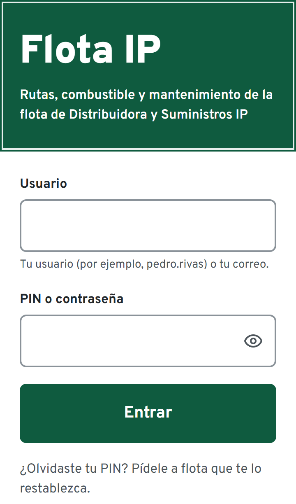
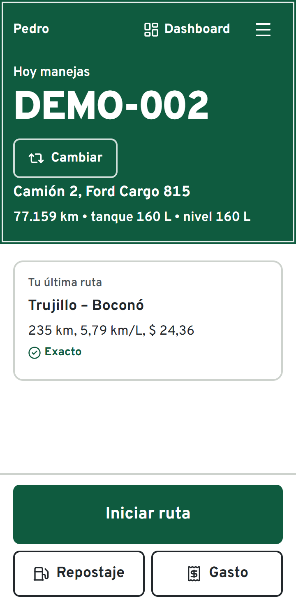
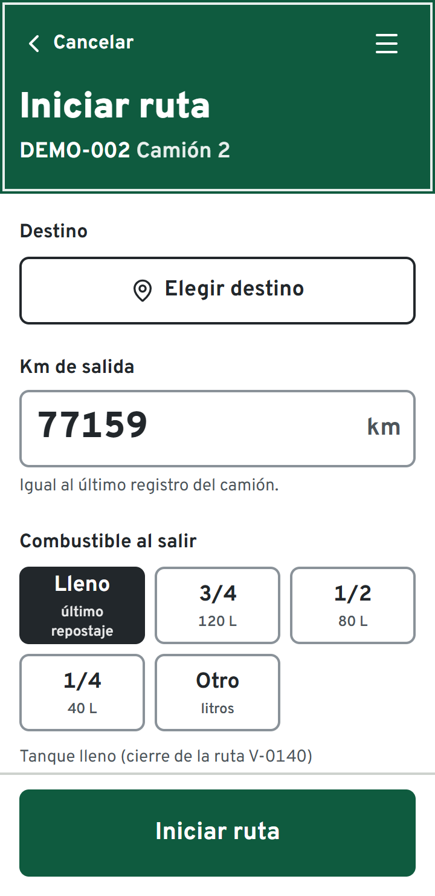
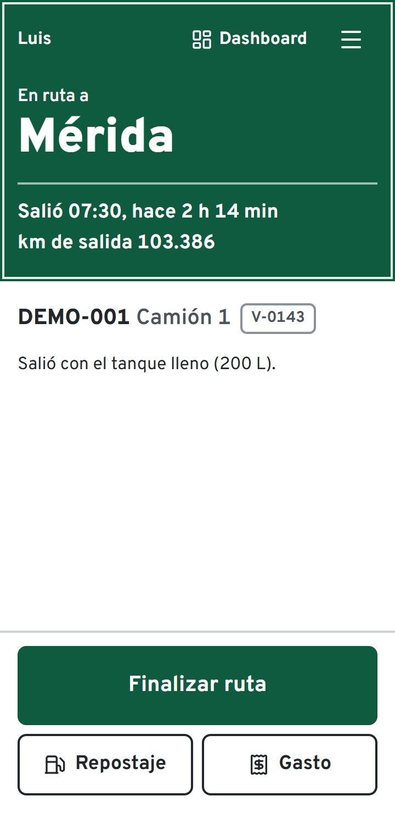
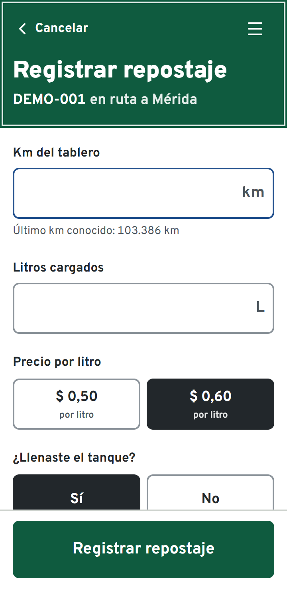
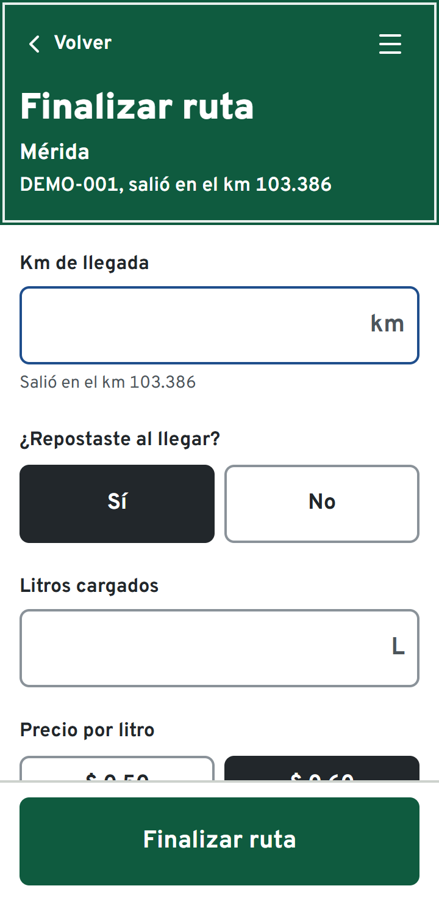
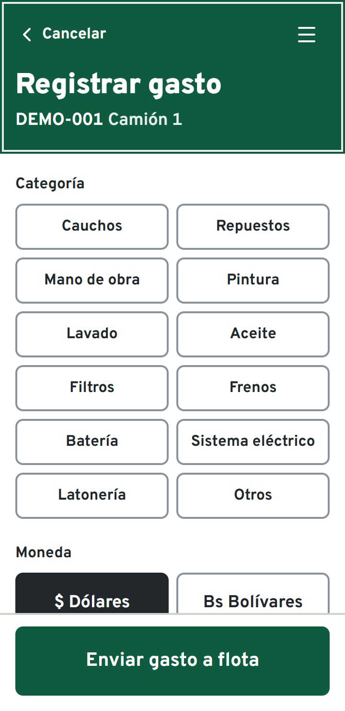

# Flota IP · Manual del chofer

Con Flota IP anotas cada ruta, cada carga de combustible y cada gasto del camión desde el teléfono. Te toma menos de un minuto y funciona aunque no tengas señal.

<table>
<tr>
<td width="33%"></td>
<td width="33%"></td>
<td width="33%"></td>
</tr>
<tr>
<td valign="top"><b>1. Entra</b> con el usuario y el PIN de 6 dígitos que te da flota. La primera vez, instala la app: en Android, menú de Chrome → <i>Agregar a pantalla de inicio</i>; en iPhone, Safari → Compartir → <i>Agregar a inicio</i>.</td>
<td valign="top"><b>2. Revisa el camión.</b> Arriba ves el camión que manejas hoy. Si es otro, toca <b>Cambiar</b>. Luego toca <b>Iniciar ruta</b>.</td>
<td valign="top"><b>3. Inicia la ruta.</b> Elige el destino (si vas a varios clientes, agrégalos en orden; si no está, elige <i>Otro</i> y escríbelo en la nota). Confirma el km del tablero y marca el combustible al salir. Si te equivocaste, toca <b>Deshacer</b> en los 10 segundos siguientes.</td>
</tr>
<tr>
<td></td>
<td></td>
<td></td>
</tr>
<tr>
<td valign="top"><b>4. En ruta</b> la pantalla te dice a dónde vas y desde cuándo. No hace falta tocar nada mientras manejas.</td>
<td valign="top"><b>5. Si cargas combustible en el camino</b>, toca <b>Repostaje</b>: km del tablero, litros, precio por litro y si llenaste el tanque. La foto del recibo es opcional.</td>
<td valign="top"><b>6. Al llegar</b>, toca <b>Finalizar ruta</b>: km de llegada y si repostaste. Si llenaste, la app calcula todo sola; si no, marca dónde quedó la aguja. Antes de confirmar ves el rendimiento y el costo.</td>
</tr>
</table>

**7. Gastos del camión** (cauchos, aceite, lavado…): toca **Gasto**, elige la categoría, la moneda (dólares o bolívares) y el monto. Puedes añadir la foto de la factura. Queda **Por aprobar** hasta que flota lo revise; en el menú ☰ → *Mis rutas y registros* ves si lo aprobaron o rechazaron, y por qué.

**Sin señal.** Sigue trabajando normal. Lo que registres queda guardado en el teléfono con la marca **Pendiente de envío** y se envía solo cuando vuelve la señal. Mientras tengas pendientes, no cierres sesión ni borres la app.

**Si te equivocaste.** Tienes 30 minutos para corregir una ruta y sus cargas: al finalizarla, toca **Corregir datos**. Si el error está en un gasto, o ya pasó ese tiempo, avísale a flota: ellos lo corrigen y queda anotado el motivo.

**Si la app te avisa algo en rojo**, lee el mensaje: siempre dice qué número no cuadra y cómo arreglarlo (por ejemplo, un km de llegada menor que el de salida).

**¿Olvidaste el PIN?** Pídele a flota que te lo restablezca.
